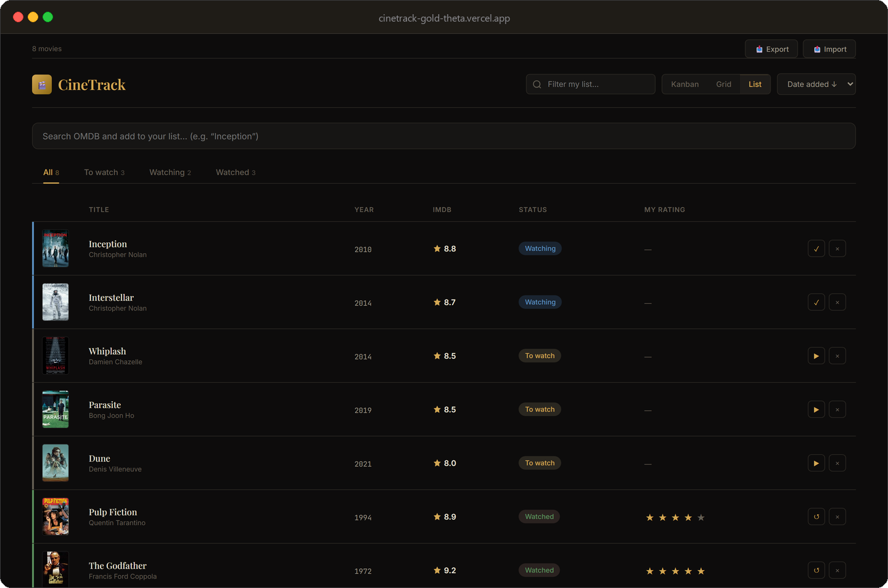

# CineTrack

A movie watchlist built with React and the OMDB API. Search for a film, add it to the board
and move it through three states: pending, watching and watched.

**[Live demo](https://cinetrack-gold-theta.vercel.app)**



## What it does

- Search movies by title through the OMDB API
- Organise them in a kanban board, a poster grid or a compact list
- Rate each movie from one to five stars and add a short note
- Persist the whole board in `localStorage`

## Setup

CineTrack needs an OMDB API key. You can enter it in the setup screen on first run — it is
stored in `localStorage` and only sent to OMDB — or provide a default for every visitor by
setting `VITE_OMDB_API_KEY` (see `.env.example`).

```bash
npm install
npm run dev
```

## Structure

```
src/
├── api/omdb.js                # Search and detail requests
├── components/
│   ├── ApiKeySetup.jsx        # First-run key screen
│   ├── MovieBoard.jsx         # State shared by the three views
│   ├── KanbanView.jsx
│   ├── GridView.jsx
│   ├── ListView.jsx
│   ├── MovieModal.jsx         # Details, rating and notes
│   └── OmdbSearch.jsx
├── App.jsx
└── index.css
```

## Notes

There is no backend: the watchlist lives in the browser, so clearing site data erases it.
The free OMDB tier returns 10 results per query, and the app does not paginate.
